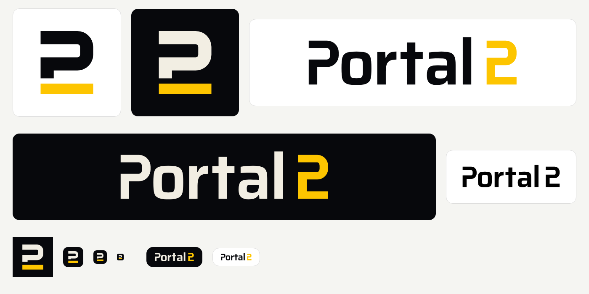

# Portal 2 logo

The logo has two forms of the same idea:

- **Symbol (collapsed).** One glyph that reads as a **P** and as a **2**. The bowl is open at the top-left like a 2's hook, the stem drops like a P's, and the 2's base splits off as a yellow cursor bar (`P_`).
- **Wordmark (expanded).** The glyph unfolds into **Portal 2**: the P stays, "ortal" follows, and the 2 slides out to the end in yellow.

Use the wordmark where there is room (headers, README, slides). Use the symbol where there isn't (favicon, app icon, avatar, collapsed navigation).

## Files

All files are vector SVG with every shape as a path (no live text, no images, no filters).

| Folder | File | Use |
|---|---|---|
| `symbol/` | `portal2-symbol-color.svg` | Main symbol, on light backgrounds |
| | `portal2-symbol-reversed.svg` | On dark backgrounds (the docs page) |
| | `portal2-symbol-black.svg` / `-white.svg` | One colour: print, stamps, embossing |
| | `portal2-symbol-small-color.svg` / `-small-reversed.svg` | Small-size cut for 32 px and below: wider gap and thicker bar |
| | `portal2-app-icon.svg` | Small cut on a dark rounded tile |
| `wordmark/` | `portal2-wordmark-color.svg` | Main wordmark, on light backgrounds |
| | `portal2-wordmark-reversed.svg` | On dark backgrounds |
| | `portal2-wordmark-black.svg` / `-white.svg` | One colour |
| `web/` | `favicon.svg`, `favicon.ico`, `favicon-16/32/48.png` | Browser tab: dark tile, readable on light and dark tab bars |
| | `apple-touch-icon.png`, `icon-192.png`, `icon-512.png`, `maskable-512.png` | Home screen / PWA |
| | `site.webmanifest`, `head-snippet.html` | Copy the tags in the snippet into the page `<head>` |

## Colour

The colours are the docs page's own tokens (`web/src/styles/tokens.css`).

| Role | HEX | RGB | Token |
|---|---|---|---|
| Ink: the P and the text on light backgrounds | `#07080C` | 7 8 12 | `--bg` |
| Cream: the P and the text on dark backgrounds | `#F2EEE3` | 242 238 227 | `--text-1` |
| Gold: the bar and the 2 | `#FDC500` | 253 197 0 | `--gold` |

- Gold is always the 2's colour: the bar in the symbol, the full 2 in the wordmark. Don't use it for the P or for "ortal".
- On light backgrounds, gold is decoration (about 1.6:1 against white). The P carries the shape, so the logo stays legible, but don't set small text in gold on white.
- On a gold background, use the one-colour black version.

## Type

- **Wordmark:** "ortal" is Saira SemiBold, converted to outlines. The P and the 2 are drawn custom from the symbol's geometry, at Saira's stem weight (horizontal strokes about 12 % thinner, as in Saira).
- **Spacing** is set by eye from the shapes, not by the font's default spacing. The gaps between the letters' ink, in font units at 1000 per em: P–o 44, o–r 92, r–t 64, t–a 64, a–l 112, l–2 240. Don't re-set the word in live type: use the SVG.
- **Text next to the logo** (taglines, UI): Lexend, the docs page font.
- Saira and Lexend are under the SIL Open Font License, which allows use in a logo.

## Clear space and minimum size

- **Clear space:** keep a margin around the logo equal to the width of the P's stem: 40 units on the symbol's 256 grid, about 1/6 of the symbol's height. For the wordmark, use the stem of its P.
- **Symbol:** use the small cut at 32 px and below. It still holds at 16 px (`favicon-16.png`).
- **Wordmark:** at least 20 px tall on screen and 8 mm in print. Below that, use the symbol.

## Don't

- Close the gap at the P's top-left, or join the bar back to the stem. The gap is what makes it read as both a P and a 2.
- Recolour the parts, swap ink and gold, or add gradients, shadows or outlines.
- Stretch, slant or rotate it, or re-space the letters.
- Use the colour (ink) version on dark backgrounds. Use the reversed version.
- Put the symbol in front of the wordmark. The wordmark already contains it (P…2).

## Notes

- **Trademark:** "Portal 2" is also the name of Valve's video game. Before publishing under this name (npm, a domain, an app store), check the trademark position or consider a different name; the P2 symbol works without the words.
- **Integration:** the files here are not wired into the app yet. The current favicon is `web/public/favicon.svg`, and the topbar mark is `.brand__mark` in `web/src/components/TopBar.tsx` and `LoginPage.tsx`.
